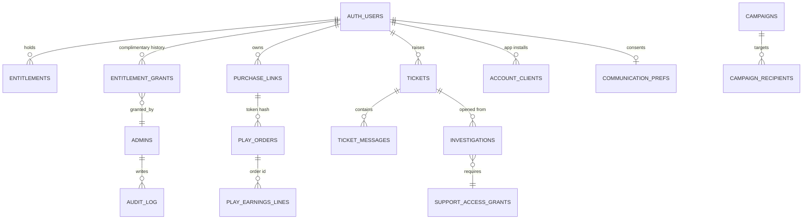

# Data Architecture

## 1. Principles

1. **Read in place, write through functions.** Mission Control doesn't copy customer ledgers. It reads production
   through `mc` functions and writes only through `mc` functions that audit in the same transaction.
2. **One `mc` schema in production** for operational state that must be atomic with customer data (grants, audit,
   investigations, tickets linked to accounts). External telemetry (Play reports, crash exports, email events) is
   ingested into `mc` tables too, because the founder's questions join them to accounts and products. Volumes are small.
3. **Snapshots preserve history.** A nightly job writes `mc.daily_metrics` before raw sources are purged (usage events
   at 90 days) or overwritten (entitlement statuses).
4. **Money in integer minor units or micros with an ISO 4217 code.** No floats. Conversion to the reporting currency
   (PHP, FD-10) uses a stated rate with source and date, stored next to the converted value.
5. **Migrations live with the others** in `lucento-android/supabase/migrations/`, are verified offline with
   `tools/sql-verify`, and are applied by the owner. `anon` and `authenticated` get no privileges on `mc`.

## 2. Sources

| Source | What it gives | How it arrives | Freshness |
|---|---|---|---|
| Production `public` tables | Ledger row counts, `server_updated_at`, entitlements, AI usage, Shared, account emails | Direct reads by `mc` functions | Live |
| Production `auth` | Account created, confirmed, last sign-in, provider, ban state | `mc` definer functions (selected columns only) | Live |
| `usage_events` (anonymous) | Activation funnel for opted-in installs | Nightly aggregate into `daily_metrics` | Daily |
| Play Developer API (purchases) | Purchase state | Already written by the website billing endpoints | Near-live (RTDN) |
| Play Orders API | Per-order listing price, tax, total, currency, region | Fetched at verification time (website) or by a Mission Control sweep | Minutes |
| Play financial reports (GCS) | Earnings: charges, fees, taxes, refunds, payouts in PHP | Monthly import of CSV/ZIP | Monthly (after month close) |
| Play stats reports (GCS) | Installs, uninstalls, ratings by country, version, device | Daily/monthly import | ~1–2 days |
| Play Developer Reporting API | Crash rate, ANR rate, error issues by version and device | Daily poll | ~1 day |
| Play Reviews API | Reviews and replies | Hourly poll | Hourly |
| Crashlytics → BigQuery | Issues, events, crash-free users (with sessions export) | Daily query of the export | Daily (batch) |
| Vercel REST | Deployments, build state, runtime errors | Webhook (deployment events) + 5-minute poll | Minutes |
| Resend | Email lifecycle events | Webhooks (`email.sent`, `delivered`, `delivery_delayed`, `bounced`, `complained`, `failed`), later inbound | Seconds |
| Health probes | Availability and latency of each service | Mission Control cron, every minute | 1 minute |
| Supabase Management API | API logs, advisors, usage | 15-minute poll | Minutes |

## 3. New tables (`mc` schema unless noted)

### 3.1 Governance

```text
admins            id uuid pk · ops_subject text unique (ops project user id) · email citext unique · display_name
                  role text → roles.key · status (invited, active, disabled) · created_at · created_by · disabled_at
roles             key text pk · label · permissions text[] · built_in bool
admin_sessions    id_hash text pk · admin_id · started_at · last_seen_at · expires_at · step_up_at · aal · ip_hash
                  ua_hash · ended_at · end_reason
approvals         id · requested_by · action · payload jsonb · reason · status (pending, approved, rejected, expired,
                  executed) · decided_by · decided_at · executes_at (cool-off) · audit_id
audit_log         see SECURITY_ARCHITECTURE.md §6 (append-only, hash-chained)
rate_counters     admin_id · bucket (action, hour) · count
```

### 3.2 Entitlements and accounts

```text
entitlement_grants   id · user_id → auth.users (on delete cascade) · grants text[] · kind (days_30, days_90, year_1,
                     lifetime, custom) · starts_at · expires_at (null only for kind=lifetime, FD-9) · reason_code
                     (tester, support_recovery, partner, giveaway, press, compensation, other) · note (≤ 500)
                     · ticket_id · granted_by → admins · granted_at · revoked_at · revoked_by · revoke_reason
                     · estimated_list_value_minor · value_currency

account_flags        user_id pk · suspended_at · suspended_by · suspend_reason · vip bool · notes_internal
                     (≤ 2,000; never shown to the customer)

deletion_requests    id · user_id · source (in_app_email, web_form, admin) · requested_at · verified_at
                     · scheduled_for (cool-off) · executed_at · cancelled_at · ticket_id

data_exports         id · user_id · requested_by · created_at · object_path · expires_at · delivered_at
```

**The live GRANT row is derived.** `public.entitlements` keeps its one `GRANT` row per account. A function
`mc.recompute_grant_row(user_id)` sets it from the active `entitlement_grants`: the union of `grants`, `starts_at` the
earliest active start, `expires_at` the latest active end (null if any active lifetime grant), `status` ACTIVE or
EXPIRED, `note` = `mc:<grant ids>`. Every grant, extend or revoke calls it in the same transaction. The app and the
existing server gates see no change in contract.

Required change to `public.entitlements` (FD-9): relax `entitlements_grant_expires` to allow `expires_at is null` for
`GRANT` rows, or (if FD-9 decides "complimentary Lifetime mirrors paid Lifetime") write two grant rows mirroring
`PLAY_LIFETIME` + `PLAY_LIFETIME_SERVICES`, which the unique index doesn't allow for one source. Recommended: add two
sources, `GRANT_LIFETIME` (LOCAL_PRO, never expires) and keep `GRANT` (expiring), so complimentary Lifetime has the
same "local forever, services for a year" shape as the paid product. The app's `Entitlement` parser must then accept
the new source before the migration ships (an app release first, so older apps ignore an unknown source safely; verify
in `EntitlementRemote`).

### 3.3 Support

```text
support_access_grants (public)   id · user_id · granted_at · expires_at · scope (records) · ticket_ref · revoked_at
                                 RLS: customer selects own; writes only through grant_/revoke_support_access()

tickets              id (human number, e.g. LC-1042) · user_id (nullable: unknown sender) · requester_email_hash
                     · requester_email (encrypted with pgsodium/Vault, deleted with account) · subject · category
                     · priority (p1 … p4) · status (new, open, pending_customer, pending_internal, resolved, closed)
                     · assignee_id · channel (email, in_app, play_review, web_form) · created_at · first_response_at
                     · resolved_at · ai_category · ai_confidence · tags text[]
ticket_messages      id · ticket_id · direction (inbound, outbound, note) · author_admin_id · body_text · body_html
                     · resend_email_id · created_at · ai_drafted bool
ticket_attachments   id · message_id · storage_path (private bucket mc-attachments) · mime · bytes · sha256 · scanned
ticket_events        id · ticket_id · at · actor · kind (status, assign, priority, merge, link) · from · to
response_templates   id · title · body · category · variables text[] · updated_by · updated_at
investigations       id · admin_id · user_id · ticket_id · mode (read, assist) · reason · support_grant_id
                     · break_glass_reason · started_at · expires_at · ended_at · end_reason
```

In-app contact (later app release): `public.create_support_request(category, message, diagnostics jsonb)` under the
customer's JWT, which inserts a ticket with an allow-listed diagnostics object (app version, Android version, device
class, sync on/off, last sync per table, plan source) that the person sees before sending.

### 3.4 Revenue

```text
play_orders          order_id pk · purchase_token_hash · user_id (from purchase_links, nullable) · product_id
                     · base_plan_id · offer_id · kind (new, renewal, upgrade, …) · region_code · currency
                     · listing_price_micros · tax_micros · total_micros · tax_inclusive bool · state
                     · created_at (Play) · refunded_at · refund_micros · fetched_at

play_earnings_lines  id · report_month · line_type (charge, google_fee, tax, refund, chargeback, …)
                     · order_id · product_id · buyer_country · buyer_currency · amount_buyer_micros
                     · merchant_currency (PHP) · amount_merchant_micros · source_file · source_line · imported_at

payouts              id · month · amount_minor · currency · bank_reference · recorded_by · recorded_at  (manual entry)

fx_rates_used        date · from · to · rate_numerator · rate_denominator · source
```

Lucento's own `public.entitlements` remains the source for *who has what*. `play_orders` and `play_earnings_lines` are
the source for *how much*.

### 3.5 Telemetry and operations

```text
daily_metrics        day · metric_key · dims jsonb (default '{}') · value_numeric · source · computed_at
                     · pk (day, metric_key, dims)
integration_checks   id · service · check_key · status (ok, degraded, down, unknown) · latency_ms · detail · checked_at
incidents            id · title · severity (sev1 … sev3) · status (investigating, identified, monitoring, resolved)
                     · started_at · resolved_at · public_message · affects text[] · postmortem_url
incident_updates     id · incident_id · at · author_id · body · public bool
job_runs             id · job_key · started_at · finished_at · status · rows_affected · detail
email_events         id · resend_email_id · type · at · kind (verify, reset, welcome, pro_purchase, campaign, ticket)
                     · user_id (nullable) · recipient_hash · bounce_type · campaign_id
crash_issues         issue_id · source (crashlytics, play_vitals) · title · type (fatal, nonfatal, anr)
                     · first_version · last_version · events_7d · users_7d · status · first_seen · last_seen
store_reviews        review_id · rating · language · app_version · device · text · reply_text · replied_at
                     · created_at · ticket_id
cost_snapshots       day · service · metric (gemini_tokens, resend_emails, vercel_invocations, db_size_mb …)
                     · quantity · estimated_cost_minor · currency · limit_quantity
```

### 3.6 Messaging and intelligence (later phases)

```text
communication_prefs (public)  user_id pk · product_news bool default false · consented_at · consent_text_version
                              · source (app, unsubscribe_link, admin_on_request) · withdrawn_at
announcements        id · title · body · audience (all, plan, version_range) · starts_at · ends_at · severity
                     · published_by · cta_url   (read by the app through a public view, filtered by audience)
campaigns            id · name · kind (product_news, release, education) · subject · preheader · body_html · body_text
                     · audience_def jsonb · audience_snapshot_count · status (draft, scheduled, sending, sent,
                     cancelled) · test_sent_at · scheduled_for · approved_by · sent_at · resend_broadcast_id
campaign_recipients  campaign_id · user_id · recipient_hash · status · event_at
remote_config (lucento_private)  key · value jsonb · updated_by · updated_at   (kill switches, see WHAT_WE_MISSED #6)
ai_briefings         day · body_md · citations jsonb · model · generated_at · inputs_hash
ai_questions         id · admin_id · question · answer_md · citations jsonb · tools_used jsonb · created_at
```

## 4. Instrumentation gaps and the privacy-safe way to fill them

| Need | Today | Proposed | Privacy note |
|---|---|---|---|
| App version per account | None | `public.report_client(app_version, version_code, sdk_int, device_class, locale_region)` called on sign-in and app update, upserting `public.account_clients(user_id, install_id, …, last_seen_at)` | Technical data tied to the account: add to the policy's "Your account" section (FD-2). No device model string, no IP |
| "Last active" | `last_sign_in_at` (sign-ins only); `server_updated_at` (writes only) | `account_clients.last_seen_at` from the call above, at most once a day | Same as above |
| Country | None | Paying customers: `play_orders.region_code`. Everyone: Play stats reports (aggregate) | Never infer from IP |
| Feature adoption (synced) | Derivable | Nightly counts per account → aggregated in `daily_metrics` only | Aggregates only; never shown per customer outside T1 metadata |
| Feature adoption (all installs) | 8 anonymous events | Extend the allowlist with anonymous events: `wallet_created`, `budget_set`, `goal_created`, `debt_added`, `recurring_added`, `composer_used`, `ai_read_used`, `sync_enabled` (names only, no props beyond `count`) | Still anonymous, still opt-in; an app release |
| Sync failures | Phone only | Count of failed pushes per day in the `report_client` payload (`sync_failures_24h`, `last_sync_error_code`) | Error codes only |
| Onboarding abandonment | `onboarding_step_viewed` (anonymous) | Already sufficient for a funnel | — |

## 5. Metric definitions (the single dictionary)

Every metric has a key, a definition, a source and a population. Mission Control renders the definition on hover and
in the "How is this computed?" drawer.

| Key | Definition | Population / caveat |
|---|---|---|
| `accounts.total` | Rows in `auth.users` not deleted | Signed-up accounts only; local-only users aren't counted |
| `accounts.new` | Accounts created in the period | — |
| `accounts.active_synced_{1,7,30}d` | Accounts with `account_clients.last_seen_at` or any `server_updated_at` in the window | Synced/signed-in only. Never labelled "DAU" |
| `installs.active_devices` | Play stats "active devices" | All installs, from Play, ~2 days late |
| `funnel.*` | Distinct install ids reaching each event | Opted-in installs (sample) |
| `customers.paying` | Accounts with ≥ 1 entitlement row from a PLAY_* source in ACTIVE, GRACE, CANCELLED_ACTIVE, or PLAY_LIFETIME not REVOKED | Excludes TRIAL, ON_HOLD, PAUSED |
| `customers.trial` | PLAY_SUBSCRIPTION rows in TRIAL | — |
| `customers.comp_active` | Accounts with an active `entitlement_grants` row and no paid row | An account with both counts as paying |
| `mrr.subscriptions` | Σ over paid subscription rows in ACTIVE, GRACE, CANCELLED_ACTIVE of the latest renewal order's `listing_price_micros − tax` (if tax-inclusive) normalized to a month (annual ÷ 12), converted to PHP at the month's stated rate | Excludes TRIAL, ON_HOLD, PAUSED, GRANT, Lifetime |
| `mrr.cloud_addon` | Same for `lucento_cloud` | Reported inside MRR and as its own line |
| `arr` | `mrr.total × 12` | A run-rate, labelled as such |
| `sales.lifetime` | Σ `total_micros − tax_micros` of `lucento_pro_lifetime` orders in the period, less refunds | One-time; never in MRR or ARR |
| `revenue.gross_customer` | Σ order totals incl. tax (Orders API) | Estimated until the earnings report closes the month |
| `revenue.net_estimated` | Gross − tax − Google service fee (rate from settings, 15 % with the reduced tier, FD-18) | Estimate |
| `revenue.net_reported` | Σ earnings-report lines for the month in PHP | Authoritative, monthly |
| `refunds.*` | Voided purchases and refund lines | Count and amount |
| `arpu.paying` | `revenue.net_reported` ÷ average paying customers, month | Monthly only |
| `ltv.estimate` | Shown only after 6 months of cohort data; ARPU × observed retention, labelled as a model | Hidden until there's enough data |
| `promo.comp_value` | Σ `estimated_list_value_minor` of active grants | **Not revenue and not a cost**; foregone list value |
| `crash_free_users` | Crashlytics sessions export | Opted-in installs only; Play vitals shown alongside for all |

## 6. Snapshot job

`mc.snapshot_daily(day)`, run by pg_cron at 00:30 UTC, is idempotent (upsert by `(day, metric_key, dims)`):

1. Accounts: total, new, confirmed, by provider; active synced 1/7/30 days.
2. Entitlements: paying, trial, comp, by source and product; statuses.
3. Usage (synced accounts): accounts with ≥ 1 wallet, budget, goal, recurring, debt-type wallet, Shared space; AI
   requests by plan.
4. Funnel (anonymous): distinct installs per event, by app version.
5. Email: sent, delivered, bounced, complained, by kind.
6. Support: opened, resolved, first-response and resolution medians.

`job_runs` records each run; the Operations page alerts if a day is missing.

## 7. Relationships (core)



## 8. Deletion behaviour of new tables

| Table | On account deletion |
|---|---|
| `entitlement_grants`, `account_flags`, `support_access_grants`, `account_clients`, `communication_prefs`, `campaign_recipients`, `data_exports` | Cascade delete |
| `tickets` / `ticket_messages` | Kept for the FD-16 period; `user_id` set null, `requester_email` erased, `requester_email_hash` kept only if needed for suppression |
| `play_orders`, `play_earnings_lines` | Kept (financial records); `user_id` set null |
| `audit_log`, `investigations` | Kept; bare uuid, no contents |
| `email_events` | `user_id` set null; recipient hash kept 90 days |
