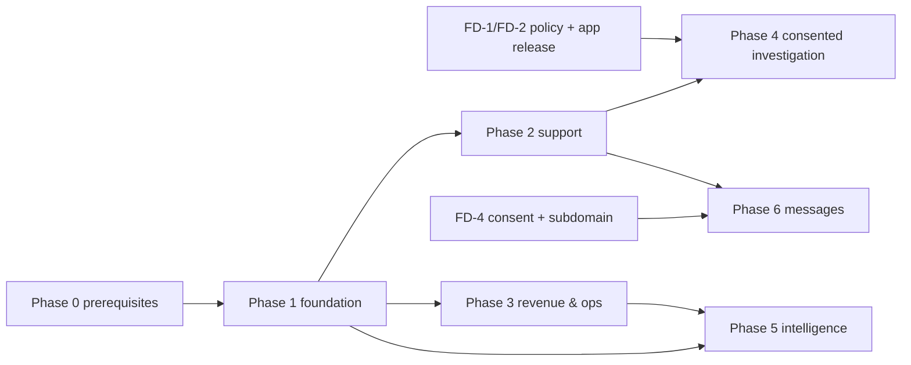

# Implementation Roadmap

Nothing here starts without the founder's approval of FOUNDER_DECISIONS.md. Phases are ordered by risk removed per unit
of effort. Each lists dependencies, the work, its complexity (S ≈ days, M ≈ 1–2 weeks, L ≈ 3+ weeks of focused work
for one engineer with Claude), and acceptance criteria that must be demonstrated, not asserted.

Repos touched: **MC** = `lucento-mission-control` (new), **AND** = `lucento-android` (migrations in
`supabase/migrations/`, plus app releases), **WEB** = `lucento-website`.

---

## Phase 0 — Prerequisites (owner actions, no code)

| Step | Decision | Owner action |
|---|---|---|
| 0.1 | FD-8 | Upgrade Supabase production to Pro; confirm backups are listed |
| 0.2 | FD-7 | Confirm or upgrade the Vercel plan; add the `mission` CNAME at GoDaddy |
| 0.3 | — | Upgrade Resend; raise Supabase Auth email rate limit; separate KlaroPH (FD-14) |
| 0.4 | FD-5 | Create the `lucento-ops` Supabase project (Free) for admin sign-in |
| 0.5 | FD-18 | Create the Mission Control Play service account; grant permissions; note the reports bucket URI |
| 0.6 | FD-17, FD-6, FD-9, FD-16 | Record the decisions |

**Acceptance:** every step confirmed with a screenshot or a read-only check (for example the Supabase organisation
plan reads `pro` through the MCP).

## Phase 1 — Foundation: identity, audit, entitlements, health, snapshots · **L**

Depends on: Phase 0.

**AND (migration, owner-applied):** the `mc` schema with `admins`, `roles`, `admin_sessions`, `approvals`, `audit_log`
(append-only, hash chain), `rate_counters`, `entitlement_grants`, `account_flags`, `deletion_requests`,
`integration_checks`, `job_runs`, `daily_metrics`, `cost_snapshots`; the `mc_app` role; functions for profile
reads, grants (with `recompute_grant_row`), revoke, purchase re-link override, deletion scheduling and execution
(sharing the cascade with `delete_my_account`), and `snapshot_daily`. FD-9 changes to `public.entitlements` follow an
app release that tolerates the new source. Offline verification suites in `tools/sql-verify` (privileges, RLS, chain
integrity, grant derivation, deletion parity).

**MC:** a Next.js app; ops-project sign-in with mandatory MFA; session and step-up handling; Today (health strip,
attention queue, key numbers, no AI yet); Customers directory and profile (T1 metadata only); the grant, extend and
revoke dialogs; resolve purchase link; re-verify purchase (calling WEB); password recovery; scheduled deletion;
Operations (synthetic checks, jobs, quotas, Supabase advisors); Audit log; Team & access (admin invite, roles).

**WEB:** tag outgoing emails with `kind` and `uid`; heartbeat from the voided-purchases cron; a server-to-server
"re-verify" endpoint for MC (shared secret, rate-limited).

**Acceptance:**
1. An admin without MFA can't load any data; a session idles out after 30 minutes; step-up is demanded for > 90-day
   grants, deletion and purchase re-link (demonstrated in a recorded run on lucento-test).
2. Granting 30 d / 90 d / 1 yr / Lifetime (per FD-9) / custom creates the history row, derives the single GRANT row
   correctly, and the phone shows Pro after its refresh (debug build against lucento-test).
3. Revoking a grant on an account that also has a Play entitlement leaves the Play row and the customer's Pro intact
   (SQL test + device check).
4. Every write appears in the audit log with actor, reason, before and after; deleting or updating an audit row fails
   for every role including `mc_app`; `verify_audit_chain` passes and detects a tampered row in a test.
5. The browser bundle contains no Supabase key other than the ops publishable key (CI grep).
6. `mc_app` can't select from any `public` or `auth` table directly (privilege test).
7. The health strip turns `unknown` when checks stop, and `down` when a probe target fails (fault injection on a
   preview).
8. The snapshot job runs daily on production, and missing days are alerted.

## Phase 2 — Support · **M–L**

Depends on: Phase 1; FD-11; Resend receiving (MX record).

**AND:** `tickets`, `ticket_messages`, `ticket_attachments` (private bucket), `ticket_events`, `response_templates`,
`email_events`; a data-subject request tracker.
**MC:** the Support inbox (three panes), templates, internal notes, SLA timers, the customer side panel, "Investigate"
(T1 metadata view), Play reviews (list, reply, make a ticket), DSR tracker. Resend inbound and delivery webhooks.
**AND app release (with FD-1/FD-2/FD-3 if approved):** in-app Contact support with a diagnostics preview;
`report_client`; the consolidated policy text.

**Acceptance:** an inbound email becomes a ticket linked to the right account within a minute; a reply arrives from
`support@`; webhooks show delivery state; attachments never become publicly reachable (signed URLs, expiry tested);
first-response and resolution times compute correctly on fixtures.

## Phase 3 — Revenue and operations depth · **M–L**

Depends on: Phase 1; Play service account permissions; real purchases in production.

**AND:** `play_orders`, `play_earnings_lines`, `payouts`, `fx_rates_used`, `incidents`, `incident_updates`,
`crash_issues`, `lucento_private.remote_config`.
**WEB:** capture order amounts via `orders.get` after each verification; read kill switches.
**MC:** Revenue (MRR vs Lifetime, statement, reconciliation, refunds, complimentary tracker, Lifetime-services renewal
cohort); monthly earnings import; Play vitals and Crashlytics BigQuery; Vercel deployments; incidents with in-app
notices; kill switches.

**Acceptance:** for a test month, MRR, Lifetime sales and net reconcile to the earnings report to the centavo, with
every difference itemized; Lifetime never appears in MRR (unit tests on fixtures including trials, on-hold, grace,
refunds, annual normalization); a kill switch takes effect in the proxy within 60 seconds.

## Phase 4 — Consented investigation and in-app announcements · **L**

Depends on: FD-1 = A, FD-2 policy shipped, an app release with the support-access switch and actor labelling.

**AND:** `support_access_grants` and its RPCs; `investigations`; `mc.inv_*` read functions with scope logging;
enumerated assisted-action functions; `announcements` + the app's reader; break-glass.
**MC:** Investigation mode (banner, timer, masked fields, reveal logging, Assist with diff and step-up).

**Acceptance:** without an active grant, every `inv_*` function refuses (tested per function); a grant's expiry ends a
live session within a minute; each assisted action is reversible or shows why not, and the customer's app labels the
change; break-glass notifies the Owner and records the 72-hour customer notice task.

## Phase 5 — Product intelligence and Founder Intelligence · **M**

Depends on: ≥ 30 days of `daily_metrics`; FD-3; FD-12.

**MC:** Product (funnel with sample labelling, adoption, versions, reviews themes); rule-based anomalies; the daily
briefing; Ask with tool calls over the metric catalogue; citations; a token budget.

**Acceptance:** on an evaluation set of 30 questions with known answers, every number in an answer matches its cited
metric (automated check); questions outside the catalogue are refused with an explanation; the model never receives
customer records (request logging proves it); a prompt-injection fixture in a ticket can't trigger any action.

## Phase 6 — Messages (consented email) · **M**

Depends on: FD-4 = A or B, the opt-in in an app release, the policy, a marketing subdomain with SPF/DKIM/DMARC.

**AND:** `communication_prefs`, `campaigns`, `campaign_recipients`.
**MC:** segments (always ∩ consented), the builder with previews, test send, schedule, approval, typed confirmation, a
10-minute cancellable queue, history and performance; unsubscribe handling mirrored to Resend Topics.

**Acceptance:** a campaign can't be sent without a test send in the last hour and a typed count; an unsubscribed or
complained address can't be re-added by import; a send to a segment never includes a non-consented account (property
test on fixtures).

## Dependency graph

## Cross-cutting rules for every phase

- Feature branches only; migrations verified offline before the owner applies them (test first, then production).
- Preview deployments point at lucento-test only; production credentials exist only in the Production environment.
- No phase is called done without its acceptance criteria demonstrated (CI output, a recording or a test log), per
  CLAUDE.md "never claim a build or test passed without seeing it pass".
- `docs/handover/` gets a Mission Control section once Phase 1 starts.
